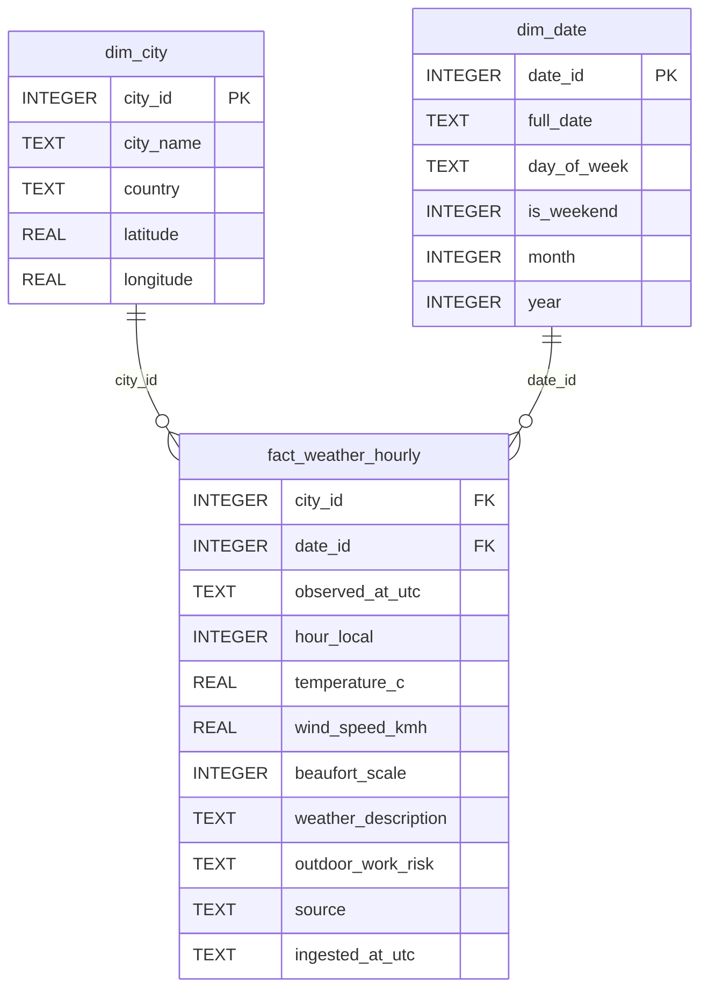

# Entity relationship diagram

**Grain:** one row per city, per hour, per source.

`fact_weather_hourly` holds the measurements. `dim_city` and `dim_date` describe them. `date_id` is the London (local) calendar date of the observation. The primary key `(city_id, observed_at_utc, source)` lets the load upsert safely, and `source` allows a second weather source later.

